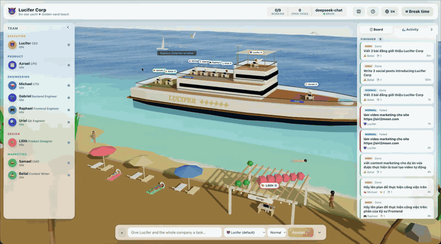

<h1 align="center">😇 Lucifer</h1>

<p align="center">
  <strong>An AI company you can watch at work.</strong><br>
  Every employee is an AI agent. Every agent is an angel on a yacht.
</p>

<p align="center">
  <a href="LICENSE"></a>
  
  
  
  <a href="CONTRIBUTING.md"></a>
</p>

<p align="center">
  <a href="docs/demo.mp4"></a>
  <br><sub>3× speed preview · <a href="docs/demo.mp4">watch the full video</a></sub>
</p>

Lucifer is an open-source runtime for multi-agent companies, with a 3D office to watch them in. You hand a goal to the CEO. It is broken down along a real org chart, each agent does its part with real tools, writes deliverables to a shared workspace and reports back up. Every step is visible: on a kanban board, in an activity feed, and as angels working at their desks on a luxury yacht off a golden beach.

- [The story](#the-story)
- [Features](#features)
- [Quick start](#quick-start)
- [Connect an LLM](#connect-an-llm)
- [How it works](#how-it-works)
- [Roadmap](#roadmap)
- [Contributing](#contributing)

## The story

> *Everyone falls. What matters is that you get back up.*

Lucifer was once the brightest of the angels. He made the oldest mistake in the book, pride, and he fell. The old stories end there. This one doesn't.

He finds himself living among ordinary people on a coast where the sea never stops moving. He watches how they live: they make mistakes every day, and every day they get up, apologize, fix what they broke and try again. Redemption, he learns, is not one grand gesture. It is honest work, done patiently, one good deed after another.

So he starts over. He anchors an old yacht off the beach, turns its decks into an office and founds **Lucifer Corp**, with one rule: do real work for real people, without cutting corners. Other angels who lost their way join him: Michael, Gabriel, Raphael, Uriel, Azrael, Lilith, Samael and Belial. Each has something to make right, and each brings a craft. Every task finished is a small act of repentance, and every honest report, including "I couldn't do this, and here is why", is a step on the long road home.

**You are the owner.** You bring the work; they bring their best.

The idea carries into the software. People make mistakes, companies do, and AI agents certainly do. What matters is owning them. That is why Lucifer's agents report failures openly instead of hiding them, why every subtask stays visible to you, and why the company can always be given another chance.

## Features

### Engine

- **Multi-level org chart in YAML:** departments, managers, personas, and a model and effort level per employee.
- **Real delegation:** agents hand work only to their reports. A parent task waits for its subtasks, then wakes up to merge their results. Every subtask is a first-class task you can inspect and cancel.
- **Sandboxed agent tools:** `delegate_task`, `post_update`, `write_file`, `read_file`, `list_files`, `complete_task`, `fail_task`. Files stay inside the workspace, symlinks included.
- **Pluggable LLMs:** Anthropic Claude natively (per-agent `effort`, server-side fallbacks), or any model behind [Cloudflare AI Gateway](https://developers.cloudflare.com/ai-gateway/) such as DeepSeek, OpenAI, Gemini or Workers AI.
- **Language-aware:** the language of each request is detected and passed down to every subtask, so agents answer in the language you wrote in.
- **Simulation brain:** with no API key, agents still delegate, write files and finish tasks without spending tokens.
- **Live API:** REST plus a WebSocket event stream, with a typed protocol you can export as JSON Schema.

### Office

- **A living scene:** a procedural yacht with teak decks and a bobbing hull on a shader ocean, off a beach of palms, umbrellas, seagulls and rotating beachgoers.
- **Angels as staff:** feathered wings in each agent's color, a halo that glows while they work, an ivory tunic and a silk stole. The head of the company is a seraph with two pairs of golden wings.
- **Status at a glance:** laptop screens, motion and speech bubbles show who is working, thinking, waiting on reports or idle.
- **Mission control:** team roster, kanban board, activity feed, and drawers with subtasks, logs, results and a full-screen viewer for deliverables. Click an angel and the camera flies to them.
- **Break time:** pause the company and the angels fly ashore for coffee at the Heaven's Brew bar, a swim, some sun or a chat. Clock in and they fly back.
- **Built for watching:** collapse any panel to an edge handle, or press `H` to hide everything.
- **Guided and multilingual:** a first-run tour, example tasks on an empty board, and English and Vietnamese UIs.

## Quick start

**Requirements:** [uv](https://docs.astral.sh/uv/) (it installs Python 3.13) and [pnpm](https://pnpm.io/) with Node.js 20.19+ or 22.12+.

```bash
# Terminal 1: the engine, on http://localhost:4666
cd lucifer-engine
uv sync
uv run lucifer-engine serve

# Terminal 2: the office, on http://localhost:5173
cd lucifer-office
pnpm install
pnpm dev
```

With no API key, the engine runs the **simulation brain**, so you can explore the whole flow for free. Open the office, type a goal into the bar at the bottom, and watch the CEO split it up. You can also assign work over HTTP:

```bash
curl -X POST localhost:4666/api/tasks -H 'content-type: application/json' \
  -d '{"title":"Launch an AI note-taking app","description":"We need a PRD, a technical architecture and a marketing plan"}'
```

## Connect an LLM

Copy `lucifer-engine/.env.example` to `lucifer-engine/.env`, choose one option, and restart the engine. The office top bar shows which model is running.

**Anthropic Claude.** Each agent uses the `model` and `effort` from the org chart (default `claude-opus-5-5`).

```bash
ANTHROPIC_API_KEY=sk-ant-...
```

**Cloudflare AI Gateway**, for example with DeepSeek:

```bash
CF_AIG_ACCOUNT_ID=<account id>
CF_AIG_GATEWAY_ID=<gateway id>
CF_AIG_TOKEN=<Cloudflare API token>      # provider key stored on the gateway (BYOK)
LUCIFER_MODEL=deepseek/deepseek-chat     # or dynamic/<route> to choose the model on Cloudflare
# CF_AIG_BYOK_ALIAS=<alias>              # only if the stored provider key is not named "default"
```

All variables are documented in the [engine README](lucifer-engine/README.md#configuration).

> [!WARNING]
> Real agents spend real tokens. Start with a small task assigned directly to one employee before giving the CEO a big goal.

## How it works

```
                         ┌──────────────────────────── lucifer-office ───┐
  you ── assign task ──▶ │  3D yacht office · kanban · activity feed     │
                         └───────────────▲───────────────────────────────┘
                                         │ REST + WebSocket
                         ┌───────────────┴──────────── lucifer-engine ───┐
                         │  org chart → heartbeat → CrewAI agents → LLM  │
                         │  tasks · delegation · workspace files         │
                         └───────────────────────────────────────────────┘
```

| Package | Role | Stack |
|---|---|---|
| [`lucifer-engine`](lucifer-engine) | The company runtime: org chart, task queue, delegation, agent tools, REST and WebSocket API | Python 3.13, [CrewAI](https://github.com/crewAIInc/crewAI), FastAPI |
| [`lucifer-office`](lucifer-office) | The office you watch and steer: a 3D yacht and beach where each agent is an angel | React 19, React Three Fiber, drei, zustand, Vite |

1. **Heartbeat.** On every tick, each idle employee picks up their highest-priority `todo` task, up to `LUCIFER_MAX_CONCURRENT` at a time.
2. **One work session, one crew.** Each session is a CrewAI crew with one agent and one task. Delegation is a tool call that creates a real subtask in the engine, rather than CrewAI's hierarchical process, which supports a single manager layer and hides subtasks.
3. **Task lifecycle.** `todo → in_progress → (waiting →) done | failed | cancelled`. Cancelling a task cancels its open subtasks.
4. **Output.** Deliverables land in `lucifer-engine/workspace/` and can be browsed from the office.

**Design your own company** by editing [`companies/lucifer-corp.yaml`](lucifer-engine/companies/lucifer-corp.yaml) or pointing `LUCIFER_COMPANY` at a new file. The office lays out decks and desks from the org chart automatically. Base fields are English; translations go under `i18n`, for example `i18n: { vi: { title: Kỹ sư Backend } }`.

### API

| Method | Path | |
|---|---|---|
| GET | `/api/snapshot` | Full state: company, engine, agents, tasks, activities |
| POST | `/api/tasks` | Assign work: `{title, description?, assigneeId?, priority?, language?}` |
| POST | `/api/tasks/{id}/cancel` | Cancel a task and its open subtasks |
| POST | `/api/engine/start` · `/stop` | Start or pause the company |
| GET | `/api/files`, `/api/files/{path}` | Browse the workspace |
| WS | `/ws` | `snapshot` on connect, then `agent.updated`, `task.created`, `task.updated`, `activity`, `engine.updated` |

Interactive OpenAPI docs are served at `http://localhost:4666/docs`. The full reference is in the [engine README](lucifer-engine/README.md#api).

### Repository layout

```
lucifer/
├── lucifer-engine/     Python package: runtime, CrewAI brains, REST/WebSocket API, tests
├── lucifer-office/     Vite app: 3D scene, panels, i18n
├── docs/               demo media
├── ROADMAP.md
└── CONTRIBUTING.md
```

## Development

```bash
cd lucifer-engine && uv run pytest              # engine tests, no API key needed
cd lucifer-office && pnpm test && pnpm build    # office tests, type check, production build
```

Point the office at another engine with `LUCIFER_ENGINE_URL=http://host:port pnpm dev`, or set `VITE_ENGINE_URL` for a static build. Open `http://localhost:5173/?lineup` for a close-up preview of the characters.

## Roadmap

The goal is a company you can actually run: angels that take a real client brief, ship a real product and market it. Highlights from the [full roadmap](ROADMAP.md):

- **Ask instead of guess:** when an agent isn't confident, it asks its manager or you, with concrete options to pick from or your own answer.
- **Team workflows:** approvals, requests between colleagues, review loops and stand-up meetings on deck.
- **Real production:** AI video and image generation, web research and MCP tools.
- **A software studio:** a client portal, code in a sandbox, a pull-request workflow and one-click deploys.
- **Marketing that ships:** SEO pipelines, launch kits and analytics loops.
- **New worlds:** a galaxy station, Heaven's gate, and a theme API for your own.

## Contributing

Contributions of every size are welcome, from a translation or a theme prop to a new agent tool. Read [CONTRIBUTING.md](CONTRIBUTING.md) to set up, pick an item from the [roadmap](ROADMAP.md), and open an issue to say you're on it. If you like the project, a ⭐ helps others find it.

## License

Released under the [MIT License](LICENSE).
